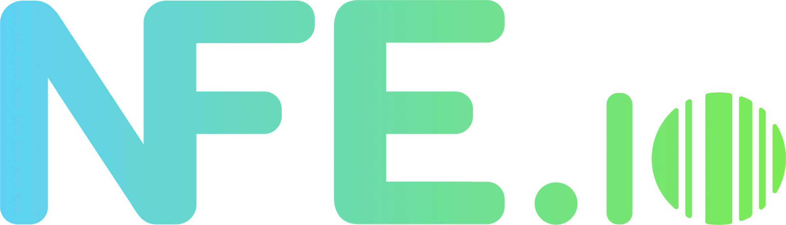
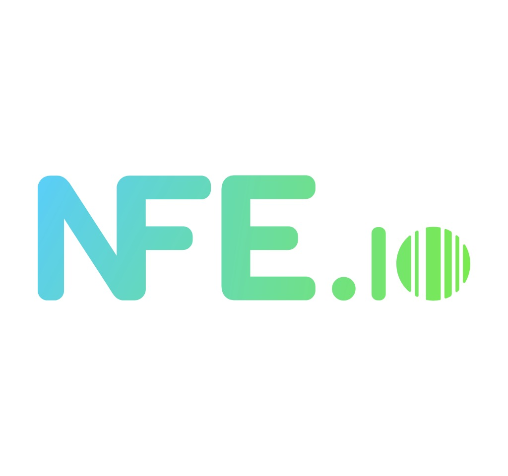
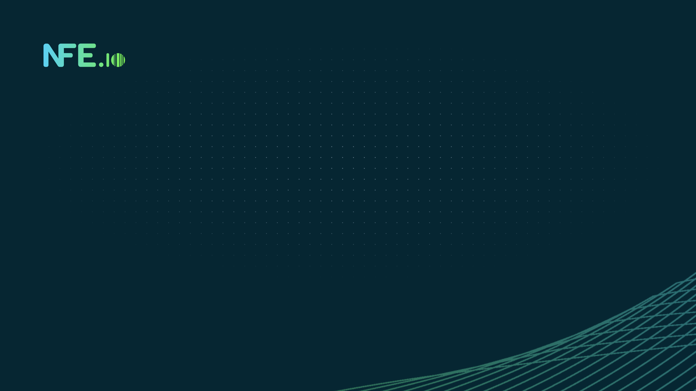
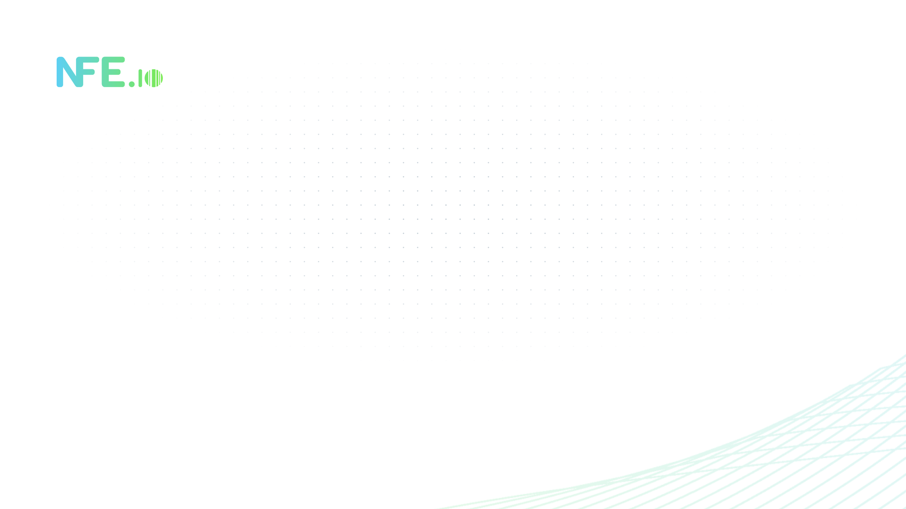
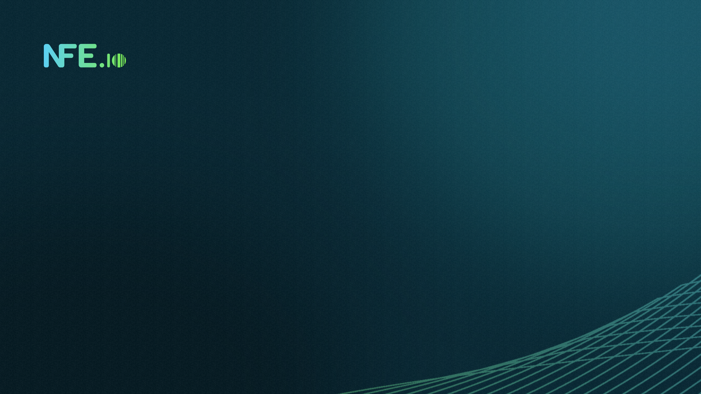
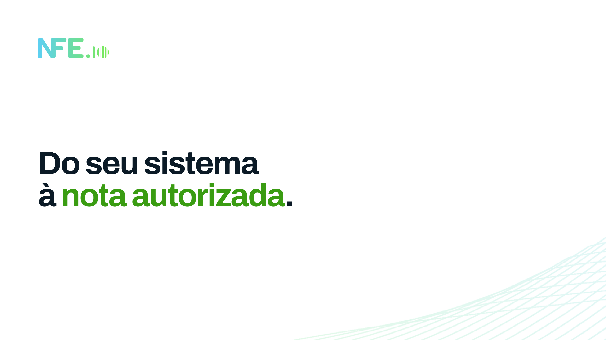
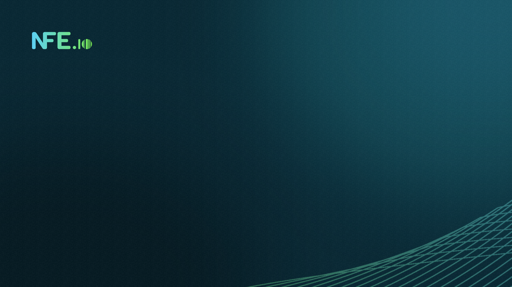
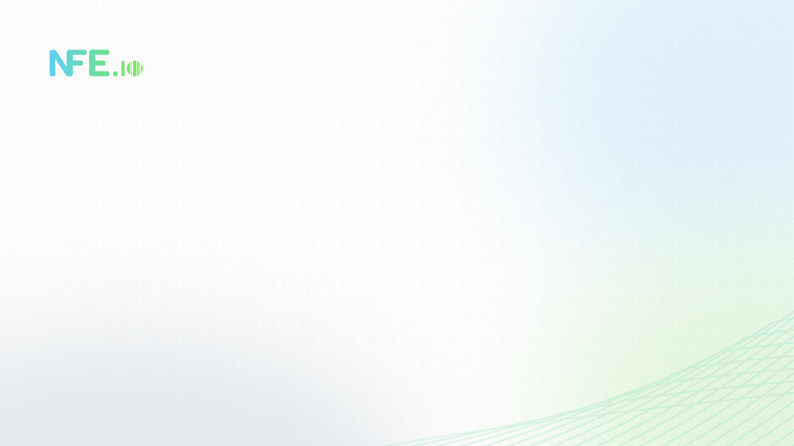

# [Media Kit NFE.io](https://nfe.io/media-kit/)

Arquivos do sistema de identidade visual da NFE.io. Fonte: Manual de Identidade Visual v3.0 e Design System Web (Figma).

## Manual de Identidade Visual

| Formato | Link |
|---------|------|
| PDF     | <a href="manual-de-identidade-visual/manual-de-identidade-visual.pdf" download target="_blank">Manual de Identidade Visual (PDF)</a> |


## [Elementos da Marca](elementos-da-marca/README.md)

### [Logos](elementos-da-marca/logos/README.md)

| Preview | Formato | Link |
|---------|---------|------|
|  | PNG | <a href="elementos-da-marca/logos/logo-branco-transparente-vemail.png" download target="_blank">Logo Branco Transparente (Email)</a> |
|  | PNG | <a href="elementos-da-marca/logos/logo-branco-transparente.png" download target="_blank">Logo Branco Transparente</a> |
|  | JPG | <a href="elementos-da-marca/logos/logo-bw-tiny-quadrado-fundo-branco.jpg" download target="_blank">Logo BW Tiny Quadrado Fundo Branco</a> |
|  | PNG | <a href="elementos-da-marca/logos/logo-colorido-fundo-transparente.png" download target="_blank">Logo Colorido Fundo Transparente</a> |
|  | SVG | <a href="elementos-da-marca/logos/logo-quadrado-branco-transparente.svg" download target="_blank">Logo Quadrado Branco Transparente (SVG)</a> |
|  | JPG | <a href="elementos-da-marca/logos/logo-quadrado-fundo-branco.jpg" download target="_blank">Logo Quadrado Fundo Branco</a> |
|  | PNG | <a href="elementos-da-marca/logos/logo-quadrado-transparente-100px.png" download target="_blank">Logo Quadrado Transparente 100px</a> |
|  | JPG | <a href="elementos-da-marca/logos/logo-quadrado-transparente.jpg" download target="_blank">Logo Quadrado Transparente</a> |
|  | GIF | <a href="elementos-da-marca/logos/logo-small-quadrado-fundo-branco.gif" download target="_blank">Logo Small Quadrado Fundo Branco (GIF)</a> |
|  | JPEG | <a href="elementos-da-marca/logos/logo-tiny-quadrado-fundo-branco.jpeg" download target="_blank">Logo Tiny Quadrado Fundo Branco (JPEG)</a> |

### Wallpapers

| Preview | Formato | Link |
|---------|---------|------|
|  | PNG | <a href="elementos-da-marca/wallpaper/nfeio-teams-01-escuro-1920x1080.png" download target="_blank">Teams 01 Escuro 1920x1080</a> |
|  | PNG | <a href="elementos-da-marca/wallpaper/nfeio-teams-02-claro-1920x1080.png" download target="_blank">Teams 02 Claro 1920x1080</a> |
|  | PNG | <a href="elementos-da-marca/wallpaper/nfeio-teams-03-teal-base-frase-1920x1080.png" download target="_blank">Teams 03 Teal base frase 1920x1080</a> |
|  | PNG | <a href="elementos-da-marca/wallpaper/nfeio-teams-04-branco-frase-1920x1080.png" download target="_blank">Teams 04 Branco frase 1920x1080</a> |
|  | PNG | <a href="elementos-da-marca/wallpaper/nfeio-teams-05-escuro-textura-1920x1080.png" download target="_blank">Teams 05 Escuro textura 1920x1080</a> |
|  | PNG | <a href="elementos-da-marca/wallpaper/nfeio-teams-06-claro-textura-1920x1080.png" download target="_blank">Teams 06 Claro textura 1920x1080</a> |
|  | PNG | <a href="elementos-da-marca/wallpaper/nfeio-wallpaper-01-escuro-2560x1440.png" download target="_blank">Wallpaper 01 Escuro 2560x1440</a> |
|  | PNG | <a href="elementos-da-marca/wallpaper/nfeio-wallpaper-02-claro-2560x1440.png" download target="_blank">Wallpaper 02 Claro 2560x1440</a> |
|  | PNG | <a href="elementos-da-marca/wallpaper/nfeio-wallpaper-03-teal-base-frase-2560x1440.png" download target="_blank">Wallpaper 03 Teal base frase 2560x1440</a> |
|  | PNG | <a href="elementos-da-marca/wallpaper/nfeio-wallpaper-04-branco-frase-2560x1440.png" download target="_blank">Wallpaper 04 Branco frase 2560x1440</a> |
|  | PNG | <a href="elementos-da-marca/wallpaper/nfeio-wallpaper-05-escuro-textura-2560x1440.png" download target="_blank">Wallpaper 05 Escuro textura 2560x1440</a> |
|  | PNG | <a href="elementos-da-marca/wallpaper/nfeio-wallpaper-06-claro-textura-2560x1440.png" download target="_blank">Wallpaper 06 Claro textura 2560x1440</a> |

### Outros Elementos

| Arquivo | Descrição |
|---------|-----------|
| <a href="elementos-da-marca/styles.css" download target="_blank">`elementos-da-marca/styles.css`</a> | Tokens de cor (tema claro e escuro), tipografia responsiva, espaçamento, raio, sombra, layout e componentes |
| <a href="elementos-da-marca/wave-pattern.png" download target="_blank">`elementos-da-marca/wave-pattern.png`</a> | Malha da marca no degradê (PNG transparente, 2519 px) |

#### Favicon

- Favicon SVG para uso em todas as páginas do site:

```html
<link rel="icon" href="elementos-da-marca/logos/favicon.svg" type="image/svg+xml">
```

- Favicon ICO para uso em navegadores que não suportam SVG:

```html
<link rel="icon" href="elementos-da-marca/logos/favicon.ico" type="image/x-icon">
```

> Tamanho mínimo do símbolo: 16 px. No cabeçalho e no rodapé, use o logotipo completo.

#### Como usar o styles.css

```html
<link rel="stylesheet" href="styles.css">

<section data-theme="dark" class="section has-mesh">
  <div class="mesh mesh--tr" aria-hidden="true"></div>
  <p class="t-overline">Sobretítulo</p>
  <h1 class="t-display">Título com <span class="highlight">destaque</span></h1>
  <a class="btn" href="#">Criar conta grátis</a>
</section>
```

- Use os tokens semânticos (`--nfe-text-primary`, `--nfe-action-primary` etc.). Os primitivos (`--nfe-*`) guardam só os valores.
- O tema claro é o padrão. Aplique `data-theme="dark"` na seção ou no `<html>`.
- O degradê (`--nfe-gradient`, #5DD0F2 → #7AEA53) é exclusivo do logotipo, do símbolo e da malha.
- A malha deve ser posicionada em um canto superior ou inferior, sem sobrepor texto e sem mostrar as extremidades. Opacidade: 20% no claro, 30% no escuro, 42% em capa e contracapa.


## Download do Repositório

Você pode baixar o repositório completo como um arquivo zip através do link abaixo:

<a href="https://github.com/nfe/media-kit/archive/refs/heads/main.zip" download target="_blank">Baixar Repositório (ZIP)</a>

Aproveite os recursos e sinta-se à vontade para baixar o que precisar!
